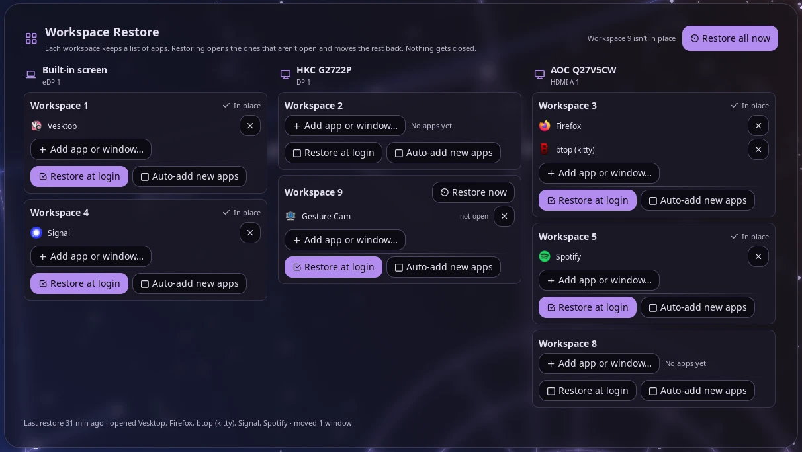

# Workspace Restore

Give each Hyprland workspace a list of apps. Restoring puts the workspace back on its screen, opens the apps on its list that aren't open and moves the open ones back, so your layout comes back at login or with one click.



## Plugin

| Field | Value |
| --- | --- |
| ID | `soulmanyes/workspace-restore` |
| Entries | Bar widget: `bar`; panel: `panel` |

## Requirements

- Hyprland 0.56 or later with the Lua config. `hyprctl` must be on `PATH`; the plugin uses `hl.dsp.window.move`, `hl.dsp.workspace.move`, `hl.dsp.workspace.rename`, `hl.dsp.focus` and `hl.dsp.exec_cmd`, and reads Hyprland's event socket.
- `python3` (standard library only). `wsr.py` does all the work; the bar widget and panel only call it.
- `setsid` (util-linux), to run a restore in the background.
- Noctalia 5.4.0 or later (plugin API 43).

## Usage

Add the `bar` widget to a bar and click it, or open the panel with:

```sh
noctalia msg panel-toggle soulmanyes/workspace-restore:panel
```

The panel has one column per screen, left to right (three per row; a fourth screen starts a second row), showing each workspace on the screen it's on now. A workspace with nothing to do (every saved app open on it, nothing unsaved, on its screen) shows as one line with its app icons; the arrow shows it in full. With more workspaces than fit, the columns scroll. Each workspace that has saved apps or is open gets a card:

- One list of apps, each with a coloured dot and a tag (a legend sits at the top):
  - green **open here**: saved here and open here
  - orange **open on ws N**: saved here but open on another workspace; restoring moves it here
  - grey **closed**: saved here, not open; restoring opens it
  - blue **not saved**: open here but not on the list
- A coloured left edge, from the saved apps and the screen only: green when every saved app is open here, orange when the workspace or a saved app is somewhere else, grey when a saved app is closed, none when nothing is saved. Apps open here but not saved don't change it.
- **×** removes an app from the list. The app keeps running.
- **Add app or window…** opens a picker with open windows on one side and installed apps on the other, with a search box. Picking an open window is the most reliable way to add an app: it records the exact launch command, Firefox profile or terminal command.
- Each blue row has its own **Add** button. If the app is saved on another workspace and has no window open there, it says **saved on ws N** and offers **Move it here**, which moves it from that list to this one. When several saved windows of the app could be the one, such as two Firefox windows, the title words pick; if they can't, only **Add** is offered.
- A workspace open on another screen than its saved one says **Saved on** *screen*. Restoring moves it back there; **Move it here** saves the screen it's on now instead. Its saved screen's column also shows a faded card for it, with **Move it back here**.
- Drag a card by its grip onto another screen's column to move the workspace there now. That screen becomes its saved screen. Pinned workspaces (see below) can't be dragged.
- **Restore now** restores the workspace right away. A workspace whose apps are all open on it, on its own screen, shows **✓ In place** instead.
- Two settings, shown as checkboxes:
  - **Restore at login**: restore this workspace when you log in (see below).
  - **Auto-add new apps**: when you open an app on this workspace that isn't on any list yet, add it to this one. It only adds, skips floating windows such as dialogs, and never brings back an app you removed from this workspace until you add it again yourself.

**Edit numbers and names** at the top turns each card's title into a number box and a name box. **Apply** gives the workspaces their new numbers and names: windows, app lists and settings stay on the same screen, only the numbers change. Names are set in Hyprland too, and restoring puts them back. It refuses while a number is used twice, or when a number is pinned to another screen. Named workspaces (below) keep their names and have no boxes.

**Workspace rules** in your Hyprland config (`hyprctl workspacerules`) count. A workspace a rule pins to a screen shows **Pinned to** *screen* and a pin instead of the drag grip: it can't be dragged or saved on another screen, and restoring puts it on the pinned screen. A rule's `defaultName` is the workspace's name unless you give it another; restoring applies it when Hyprland didn't.

**Restore all now** at the top restores every workspace; hovering it lists the apps it would open. The note next to it says which workspaces aren't in place.

If an app is on the lists more than once, such as two Firefox windows, the panel asks for a word from each window's title so restoring knows which window goes where.

### When a saved number is taken

If a saved workspace closes, Hyprland can give its number to a new workspace (for example the "first empty workspace" keybinds). The watcher notices: when a closed saved number comes back without a restore, its first window decides.

- One of its saved apps, on its saved screen: it's the saved workspace.
- An app it doesn't have: it's another workspace. The panel shows it as a separate card ("not your saved one"), and restore, auto-add and adding apps leave saved workspace N alone until that workspace closes. **It's my saved one** links them; **Give it a new number** on the saved card moves the saved workspace to a free number.
- One of its saved apps on another screen: the panel asks, and restore and auto-add wait for the answer.

Restore never drags windows that aren't on a workspace's list to another screen: before moving a workspace, it puts those windows on a new workspace on the screen they're on, and the last-restore line says so.

### Restore at login

Nothing to set up: when the bar widget starts, it restores the **Restore at login** workspaces, once per Hyprland session. Restarting the bar doesn't reopen anything; logging in again does. It waits up to 20 seconds for screens that show up after Hyprland starts. The bar widget has to be on your bar for this to run.

## Notes

- **Restoring never closes windows.** Apps that aren't on a list stay where they are. Window sizes and positions are not restored, only which workspace each window is on.
- **Launching:** an app that isn't running is started once through `hl.dsp.exec_cmd`, using its `.desktop` file's `Exec` line (or the command line it was running with). Launches carry the target workspace as an exec rule, so the app opens there even if a window rule sends it elsewhere. An installed app is matched by its `.desktop` file's `StartupWMClass` (or file name), which a few apps don't match; add those from an open window instead.
- **Named workspaces** (`workspace name:Web`, with no number) are saved and restored by name: Hyprland gives them a new negative id each session, so the id is never used. Restoring creates a missing one by moving its first app there. Their name comes from your Hyprland config, so the panel doesn't rename or renumber them, and the "saved number is taken" check doesn't apply to them. `name:` workspace rules count like numbered ones. Special workspaces are left out.
- **Screens** are matched by their description (make, model, serial), not the connector name. A workspace whose screen isn't connected is skipped.
- **Terminals** are saved only when started with a command (`kitty -e btop`) and matched by that exact command line. Plain shells are skipped.
- **Firefox** is launched with `--profile <path>` for the profile in use, which skips the profile picker; Firefox's own session restore ("Open previous windows and tabs") reopens its windows.
- After a restore from the panel, every screen shows the workspace it showed before, and focus is unchanged. The exception: a screen that showed a workspace restore moved away shows the windows it set aside instead.
- **Files written:** `$XDG_STATE_HOME/workspace-restore/` (default `~/.local/state/workspace-restore/`):
  - `layout.json`: each workspace's screen and app list
  - `config.json`: Restore at login and Auto-add workspaces, title words, and apps removed from auto-add workspaces
  - `last-restore.json`: what the last restore did
  - `restore.lock`, `state.lock`: lock files
  - `<file>.broken-<time>`: a copy of a state file that couldn't be read, made before the plugin starts that file afresh. The panel shows a red notice until you delete the copy.

  Plus, per Hyprland session, these files in `$XDG_RUNTIME_DIR`, which is cleared at logout (`<uid>-<instance>` ends each name):
  - `workspace-restore-login-…`: empty marker, so the login restore runs once
  - `workspace-restore-ids.json-…` (+ `.lock`): which saved numbers another workspace has taken
  - `workspace-restore-watch.lock-…`, `workspace-restore-heartbeat-…`, `workspace-restore-acting-…`: the watcher's lock, the bar's last check-in, and when the plugin last created workspaces itself
- **Processes started:** `python3` running `wsr.py`, which runs `hyprctl` (`-j` queries and `dispatch`); `setsid` for background restores and the watcher; and the apps on your lists when restoring.
- **Watcher:** one long-running `wsr.py watch` per session, started by the bar widget. It reads Hyprland's event socket (`$XDG_RUNTIME_DIR/hypr/<instance>/.socket2.sock`) and writes only the `ids.json` file above. It quits when Hyprland exits, when `wsr.py` changes (the bar starts the new one), or when the bar hasn't checked in for 5 minutes (plugin disabled or bar gone).
- **Polling:** the bar widget runs `wsr.py auto-add` and `wsr.py status` every 30 seconds. It reads `/proc/<pid>/cmdline` of open windows and the `.desktop` files in the XDG data dirs.
- No network access.

### Command line

```
wsr.py save [--ws N]
wsr.py status
wsr.py set-tick 1|0 WS [WS ...]
wsr.py set-keyword KEY TEXT
wsr.py candidates [--ws N]
wsr.py add-window WS (--address ADDR | --desktop ID)
wsr.py add-open WS
wsr.py remove-window WS N CLASS
wsr.py set-monitor WS
wsr.py move-window WS FROM N CLASS
wsr.py move-workspace WS DESC
wsr.py renumber [OLD:NEW ...] [--name OLD=NAME ...] [--dry-run]
wsr.py rename WS [NAME]
wsr.py set-identity WS real|borrowed
wsr.py renumber-saved WS [NEW]
wsr.py watch
wsr.py set-auto-add 0|1 WS [WS ...]
wsr.py auto-add
wsr.py restore [--all] [--ticked] [--ws N ...] [--monitor DESC] [--wait-monitors] [--once] [--dry-run]
```

Workspace arguments (WS, FROM and `--ws N`) are a number or `name:<name>` for a named workspace (quote it if the name has spaces). `rename`, `renumber`, `renumber-saved` and `set-identity` take numbered workspaces only. `save` replaces the saved lists with what's open now: every workspace, or only `--ws N`. `add-open` only adds what a workspace's list doesn't have yet. `set-monitor` saves the screen an open workspace is on now. `move-window` moves the Nth saved app of workspace FROM to WS, with its title words. `move-workspace` moves a workspace to the screen with that description and saves it there. `renumber` swaps freely (`4:2 2:4`) but refuses two workspaces ending up on one number. `rename` without a name goes back to the default. `set-identity` and `renumber-saved` are the panel's buttons for a saved number another workspace has taken (see above). `--ticked` restores the **Restore at login** workspaces. `--once` runs only on the first call per Hyprland session (a marker in `$XDG_RUNTIME_DIR`). `--dry-run` prints the Hyprland dispatches without sending them. `--state-dir DIR` uses another state folder, which is handy for testing.

## License

CC0 1.0. See [LICENSE](LICENSE).
